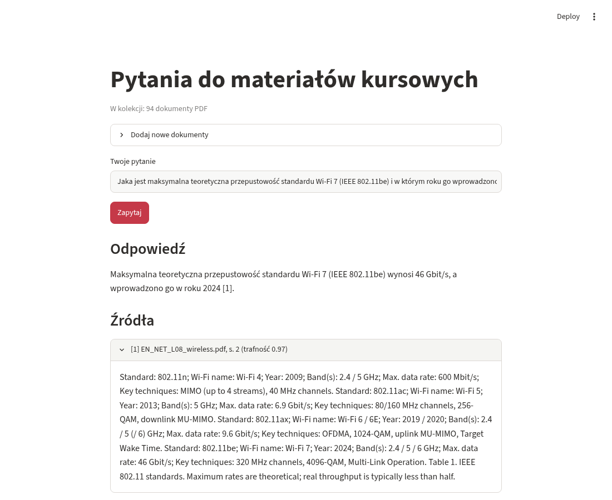
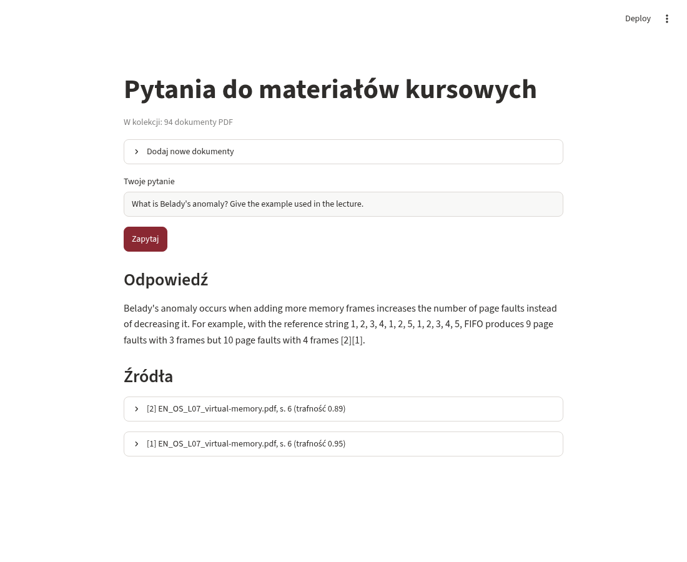
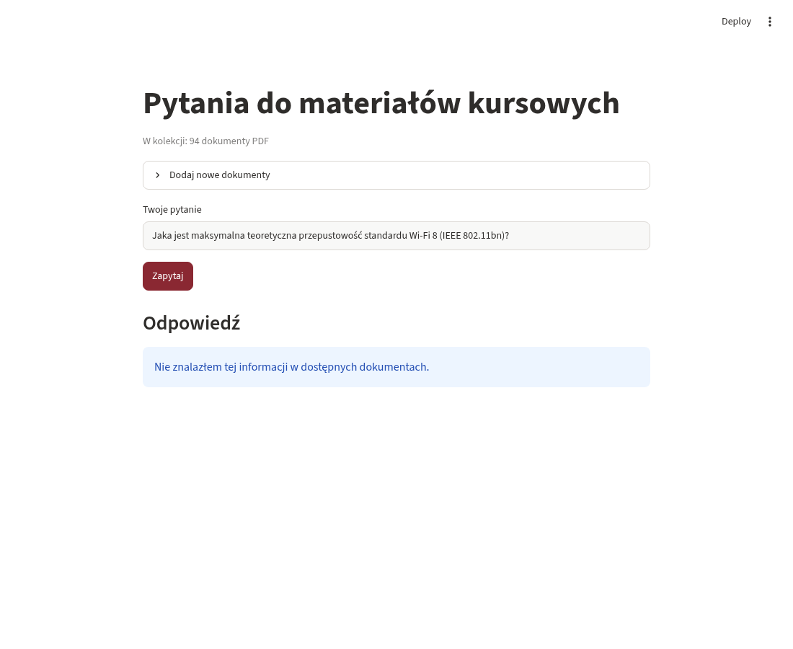
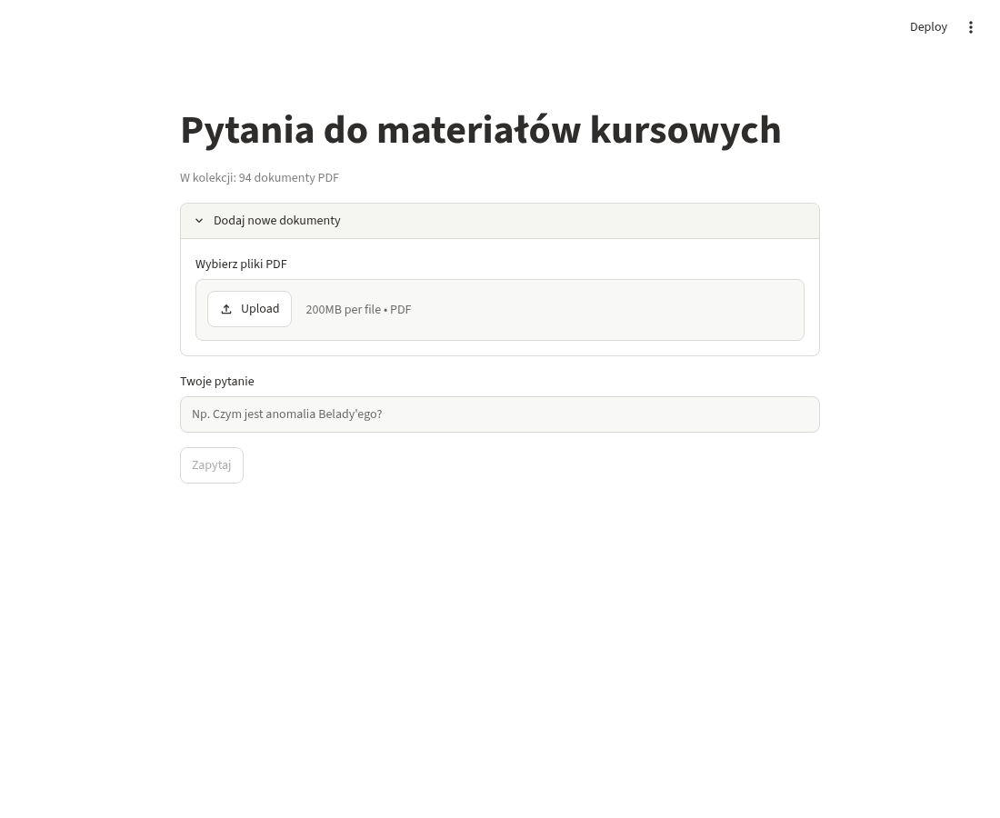

# RAG — pytania do materiałów kursowych

Aplikacja odpowiada na pytania (PL/EN) na podstawie kolekcji PDF-ów z wykładami i podaje
cytowane źródła (plik i strona). Wszystko działa lokalnie: embeddingi, reranker i LLM
(Ollama, `qwen2.5:14b`) bez zewnętrznego API. Priorytetem jest wierność źródłom: system ma
odpowiedzieć „nie znalazłem” zamiast zgadywać.



## Uruchomienie

Wymagania: Python 3.13, [Ollama](https://ollama.com), ok. 10 GB VRAM/RAM na model.

```bash
python -m venv venv && source venv/bin/activate
pip install -r requirements.txt
ollama pull qwen2.5:14b
streamlit run app.py            # http://localhost:8501
```

Przy pierwszym uruchomieniu pobierają się modele z Hugging Face
(`intfloat/multilingual-e5-base`, `BAAI/bge-reranker-v2-m3`) i budowany jest indeks
(ok. 4 min na CPU dla 94 PDF-ów). Indeks jest przebudowywany automatycznie po zmianie
plików w `pdf_files/` lub podbiciu `INDEX_VERSION` w `rag/index.py`.

## Struktura

```
app.py              interfejs Streamlit
backend.py          warstwa między UI a pipeline'em (answer(), upload, stan indeksu)
rag/ingest.py       ekstrakcja tekstu i tabel z PDF, podział na fragmenty
rag/index.py        embeddingi + indeks FAISS (index/)
rag/retrieve.py     wyszukiwanie wektorowe + reranking
rag/generate.py     generowanie odpowiedzi, kontrola języka, weryfikacja
eval/               zestaw testowy, skrypt ewaluacji, wyniki
pdf_files/          kolekcja dokumentów (94 wykłady, 10 kursów, PL + EN)
```

## Pipeline

**Indeksowanie**
1. PyMuPDF wyciąga tekst strona po stronie; pomijane są nagłówki i stopki.
2. Tabele są wykrywane przez `find_tables()` i zapisywane wiersz po wierszu jako
   `nagłówek: wartość; …`, tak by wartości nie mieszały się między wierszami. Tabele
   przechodzące na kolejną stronę dziedziczą nagłówek. Wykładniki są zachowywane (`10^23`).
3. Fragmenty po ok. 1000 znaków z zakładką 200, w obrębie jednej strony (cytat = plik + strona).
4. Embeddingi `multilingual-e5-base` (PL i EN w jednej przestrzeni) → FAISS `IndexFlatIP`.

**Odpowiadanie**
1. Wyszukiwanie wektorowe: 50 kandydatów.
2. Reranking cross-encoderem `bge-reranker-v2-m3`: top 5, próg trafności 0,15. Bez
   trafnych fragmentów system odmawia bez wywoływania LLM.
3. Generowanie (`temperature = 0`) z promptem: tylko informacje z fragmentów, cytat `[n]` po
   każdym zdaniu, dokładna formułka odmowy, bez podstawiania danych innego obiektu
   (np. innej wersji standardu).
4. Język odpowiedzi = język pytania (wykrywany słownikowo). Odpowiedź w innym języku
   lub innym alfabecie jest generowana ponownie (max 3 próby), a potem zamieniana na odmowę.
5. Kontrola cytatów w kodzie: numery spoza zakresu źródeł → ostrzeżenie.
6. Weryfikacja: drugie wywołanie LLM wskazuje twierdzenia bez pokrycia w źródłach. W kodzie
   odrzucane są fałszywe alarmy: zdania o braku informacji, „twierdzenia” nieobecne
   w odpowiedzi oraz zdania przepisane niemal dosłownie ze źródła.

## Działanie

| Pytanie po angielsku, kilka źródeł | Brak odpowiedzi w dokumentach |
|---|---|
|  |  |

Nowe PDF-y można dodać przez „Dodaj nowe dokumenty”; indeks przebuduje się przy następnym
pytaniu.



## Ewaluacja

```bash
python -m eval.run_eval            # wszystkie pytania (ok. 16 min)
python -m eval.run_eval Q08 U03    # wybrane; aktualizuje tylko te wpisy
```

`eval/questions.json` zawiera 20 pytań z oczekiwaną odpowiedzią oraz dokumentem i stroną:
15 z odpowiedzią w kolekcji (fakty, obliczenia, tabele, pytania wielodokumentowe
i międzyjęzykowe) oraz 5 pułapek (temat spoza kolekcji, sąsiedni fakt obecny w kolekcji,
fałszywe założenie). Wyniki trafiają do `eval/results.json` i `eval/results.md`
(do ręcznej oceny).

| Kategoria | Wynik |
|---|---|
| Pytania z odpowiedzią: poprawna odpowiedź | 15/15 |
| Retrieval: właściwa strona w top-5 | 15/15 |
| Cytat wskazuje właściwy dokument i stronę | 15/15 |
| Pułapki: odmowa bez halucynacji | 4/4 |
| Fałszywe założenie (U05) | częściowo: odmowa zamiast sprostowania |
| Średni czas odpowiedzi | ok. 48 s (generowanie + weryfikacja) |

## Ograniczenia

- `qwen2.5:14b` czasem przechodzi na chiński w połowie odpowiedzi. Ponowienie z poprawką
  zwykle pomaga; jeśli nie, użytkownik dostaje odmowę.
- Ponowienia mają `temperature = 0.3`, więc odpowiedzi, które ich wymagały, nie są
  w pełni powtarzalne.
- Zestaw testowy ma 20 pytań: to sprawdzian jakości, nie miara statystyczna.
- Tabela zaczynająca się na górze strony tuż po tabeli o tej samej liczbie kolumn może
  błędnie odziedziczyć jej nagłówek.
